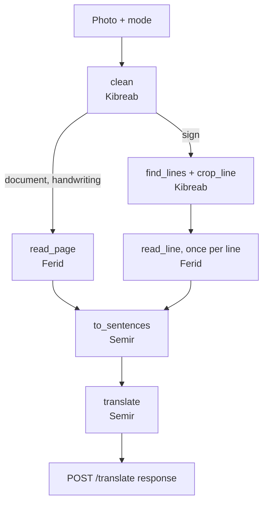

# Amharic Image Translator: Architecture

**Status:** agreed plan, 26 Oct 2026. It replaces the earlier semantic-retrieval design (in git history
before this commit). The scope change was approved by the advisor.

## 1. What it does

One photo in, Amharic read, English out.

- **Input:** one JPG or PNG photo or scan, up to 10 MB. The user picks a **mode**: `document`
  (default), `sign` (signs, posters, menus) or `handwriting` (experimental).
- **Output:** each Amharic sentence next to its English translation. Selecting a sentence highlights
  its lines on the image.
- **Not built:** storage, accounts, search, editing the recognised text, other languages or
  directions, PDFs, live camera, online hosting, training our own models.
- **Priority:** printed documents must work; signs come second; handwriting is a stretch goal whose
  accuracy is reported honestly.
- **Runs** locally on one laptop, with free and open-source tools only.

## 2. Pipeline



| Mode | `clean()` | Finding lines | Reading |
|---|---|---|---|
| `document` | straighten, crop, black and white | Tesseract's own layout analysis | Tesseract, page mode |
| `sign` | resize only (the whole photo is not straightened) | text-finder marks each line; each line is cut out, straightened, flipped to dark-on-light, padded ~10 px | Tesseract `--psm 7`, one line at a time |
| `handwriting` | as `document` | as `document` | Tesseract baseline (experimental). Surya-Fidel only if M1 and M2 are done by 15 Nov |

## 3. Lane contracts

These functions are the whole coordination surface between lanes. Each lane builds and tests against a
folder of sample photos, so nobody waits for anybody.

**Shared conventions**

- **Images** are numpy `uint8` arrays as OpenCV uses them: H×W×3 BGR for colour, H×W for grayscale.
- **Pixel boxes** are `(left, top, width, height)` integers, in the coordinate space of the image that
  `clean()` returned.
- **Line corners** (sign mode) are four `(x, y)` points, clockwise from top-left, in the same space.

| Owner | Function | Input → output |
|---|---|---|
| Kibreab | `clean(photo, mode)` | photo, mode → image, long side ≤ 2500 px. **This is the image the viewer shows; every box refers to it.** |
| Kibreab | `find_lines(image)` | → list of line corners |
| Kibreab | `crop_line(image, corners)` | → upright line image, dark text on light, ~10 px margin |
| Ferid | `read_page(image)` | → `[{"text": str, "box": (l, t, w, h)}, ...]`, one per text line, in reading order |
| Ferid | `read_line(line_image)` | → `str` |
| Semir | `to_sentences(lines)` | `[{"text", "box"}]` → `[{"amharic": str, "boxes": [box, ...]}]`. Joins lines, splits after `።` `፧` `!`, turns `፡` into a space, rejoins words split across lines, **never changes spelling**. |
| Semir | `translate(sentences)` | `list[str]` Amharic → `list[str]` English, same order |
| Semir | `pipeline.run(photo, mode)` | Wires the above. A sign line's box is the upright rectangle enclosing its corners. |

## 4. API contract (backend → frontend)

**Request:** `POST /translate`, multipart form.

- `file`: JPG or PNG, up to 10 MB.
- `mode`: `document` (default), `sign` or `handwriting`.

The call is synchronous, with no job IDs and no polling. The target is about 10 s for a typical page.

**Response:**

```json
200 {
  "mode": "document",
  "took_ms": 8421,
  "image":    { "data_url": "data:image/png;base64,…", "width": 1654, "height": 2339 },
  "segments": [
    { "id": 0, "amharic": "…", "english": "…",
      "bboxes": [ {"x": 0.10, "y": 0.18, "w": 0.80, "h": 0.04} ] }
  ]
}
```

- `image` is the image the boxes refer to (the output of `clean()`). The viewer shows it directly.
- `bboxes` are 0–1 fractions of that image, one per line, origin top-left. This is the format the
  frontend's `getBoxes` already reads.
- If no text is found, the response is `200` with `segments: []`.

**Errors** come back as `{"detail": "…"}`:

| Status | When |
|---|---|
| `400` | the file is not a readable JPG or PNG |
| `413` | the file is over 10 MB |
| `422` | `mode` is not one of the three values |
| `500` | an engine failed |

CORS allows `http://localhost:5173`. Phone photos are turned upright using their EXIF orientation tag
when the API decodes them (OpenCV does this).

## 5. Engines, hardware, licenses

| Part | Choice | License |
|---|---|---|
| OCR | Tesseract 5, `tessdata_best` `amh` and `script/Ethiopic`. Ferid picks by character error rate. | Apache 2.0 |
| Sign text-finder | PP-OCRv5 mobile detector via RapidOCR/onnxruntime. Fallback: OpenCV's DNN text detector. Unproven on Ethiopic; measured on our sign photos. | Apache 2.0 |
| Translation | `facebook/nllb-200-distilled-600M`, which we convert to CTranslate2 int8 ourselves | **CC-BY-NC 4.0 (non-commercial)**, disclosed in the report |
| Handwriting (stretch only) | `kiyam/surya-fidel-amharic` in its own Python ≤ 3.13 environment | CC-BY-NC-SA + Datalab terms |

**Translation device:**

- Translation runs on the GPU (GTX 1650; only about 1.3–1.5 GB of its 4 GB is free while the
  desktop runs).
- CUDA's cuBLAS library comes from the `nvidia-cublas-cu12` pip package, so no CUDA toolkit install
  is needed.
- If the GPU fails at load time, translation **falls back to the CPU automatically** and logs a
  warning. `TRANSLATE_DEVICE=cpu` forces the CPU.

**Environment:** one Python 3.14 venv for the main app. Every package it needs has Windows wheels
(checked 25 Oct). All models are downloaded ahead of time, so the demo runs offline.

## 6. Quality and testing

**Test set:** 25 photos.

| Group | Photos |
|---|---|
| Printed, short passages of 5–15 lines | 12 |
| Signs and posters | 8 |
| Handwritten | 5 |

Each photo gets its hand-typed Amharic and a reference English translation, about 6–7 photos per
person. They live in a **private shared folder, never this public repo**, with no real personal data in
any photo.

**Scores:**

- Character error rate (CER) for reading.
- chrF for translation.
- Translation is also scored on the hand-typed Amharic, which separates reading mistakes from
  translation mistakes.

**Code tests** (run from the repo root with `python -m pytest backend`):

- Fast tests with fake engines, covering the API contract, the box conversion, sentence splitting
  and the GPU fallback.
- One slow test with the real engines.
- The frontend's browser suite, pointed at the real API.

## 7. Schedule

| When | Milestone and tasks |
|---|---|
| 26 Oct – 1 Nov | **Setup.** Semir: this doc, API skeleton (fixed sample response) with contract tests, NLLB conversion and timing test. Ferid: Tesseract and `read_page`. Kibreab: `clean` for documents. Yassin: upload screen and mode picker against the skeleton. **Everyone: test photos in the shared folder by Tue 3 Nov.** |
| 2 – 8 Nov | **M1: printed text works end to end.** `to_sentences`, real pipeline, scoring script. Ferid picks `amh` or Ethiopic. Yassin's viewer runs on the real API. |
| 9 – 15 Nov | **M2: signs work and handwriting has a baseline.** `find_lines`, `crop_line`, `read_line`; all three modes wired and scored. **15 Nov: decide whether to attempt Surya.** |
| 16 – 17 Nov | Surya helper if M1 and M2 are done; otherwise fix the worst problems the scores showed. |
| **Wed 18 Nov** | **Feature freeze.** All models pre-downloaded; the demo runs offline. |
| 18 – 21 Nov | User tests with 5–8 people; bug fixes only; final scores go into the report. |
| 22 – 24 Nov | Rehearsal and fixes only. |
| **Wed 25 Nov** | Defense. |

## 8. Risks

1. **Sign and handwriting accuracy.** Reading Amharic signs is unproven. The best available
   handwriting model gets about 17% of characters wrong, even on clean scans.
2. **GPU memory** is shared with the display, so the translation model may land on the CPU, which is
   slower.
3. **The Surya window** is only 16–17 Nov, so handwriting will most likely ship as the Tesseract
   baseline.
4. **Ethiopian clock times** are mistranslated as Western times (section 10), which matters for signs
   showing opening hours. Report it as a limitation unless there is time to fix it.

## 9. Backend setup

```
python -m venv .venv
.venv\Scripts\pip install -r backend\requirements.txt
```

One-time model conversion. It also needs CPU torch and downloads about 2.5 GB.

```
.venv\Scripts\pip install torch --index-url https://download.pytorch.org/whl/cpu
.venv\Scripts\ct2-transformers-converter --model facebook/nllb-200-distilled-600M --quantization int8 --output_dir models\nllb-200-distilled-600M-ct2-int8 --copy_files tokenizer.json sentencepiece.bpe.model tokenizer_config.json special_tokens_map.json
```

Run the API and the tests, both from the repo root:

```
.venv\Scripts\uvicorn backend.app:app
.venv\Scripts\python -m pytest backend
```

## 10. Measurements

**26 Oct 2026, translation timing test.** 20 realistic Amharic sentences (about one page) on the demo
laptop (i5-10500H, GTX 1650):

| Device | Load at startup | 20 sentences, warm | Per sentence | GPU memory |
|---|---|---|---|---|
| GPU (CUDA via `nvidia-cublas-cu12`) | ~17 s | **0.51 s** | 0.025 s | +0.9 GB (1.8 → 2.7 of 4 GB) |
| CPU (fallback) | ~17 s | 4.2 s | 0.21 s | — |

- Translation leaves most of the 10-second budget for cleanup and OCR, even on the CPU fallback.
- Translations of the samples read correctly.
- **Ethiopian clock times** come out wrong: "ከጠዋቱ ሁለት ሰዓት" (8 a.m. in Ethiopian time) was
  translated as "2:00 a.m.".
- transformers warns about an "incorrect regex pattern" when the tokenizer loads. The warning is
  aimed at Mistral models: the tokens match the original SentencePiece model for whitespace-stripped
  text, which is what `translate()` sends.
- Found during the test: cuBLAS loads on first use, not at model load. `_open()` therefore runs one
  tiny translation at startup, so a broken GPU falls back to the CPU there rather than failing inside
  a user's request.
