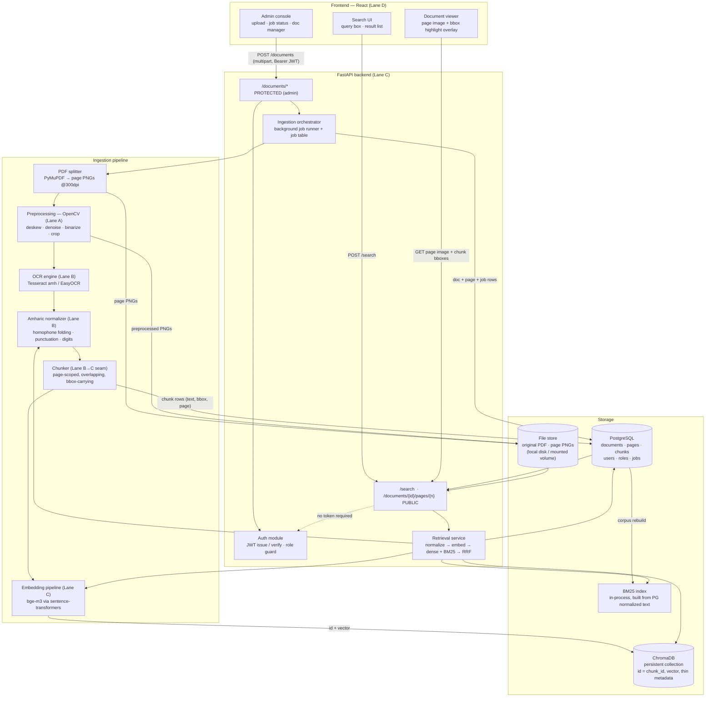
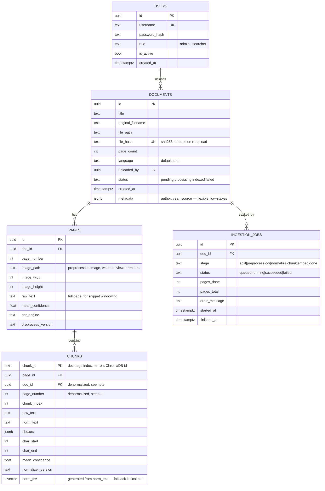
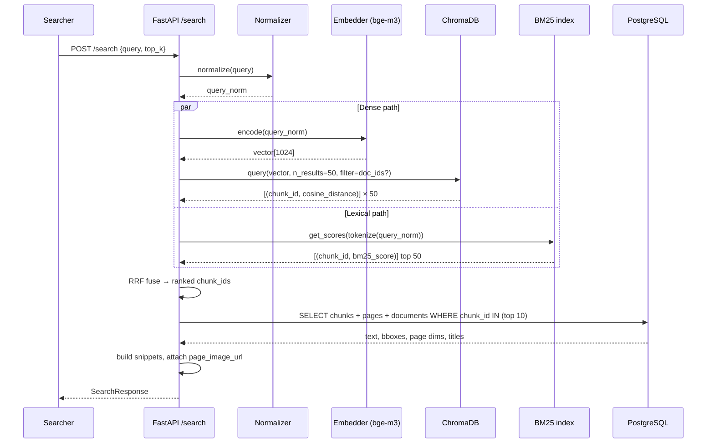
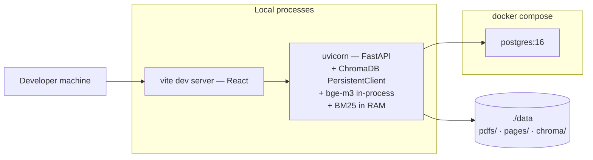

# Amharic Document Digitization & Semantic Retrieval — System Architecture

**Status:** design draft for team review (pre-implementation)
**Scope assumptions:** ~500–2,000 documents / ~20k pages; PostgreSQL for metadata; React frontend; all open-source, local-first.

This document defines *what we are building and where the seams are*. No implementation code. The
goal is that after this is agreed, each of the four lanes can build independently from week 3 onward,
because every interface between lanes is written down here.

---

## 0. The one-paragraph version

A Document Administrator uploads a scanned Amharic PDF. The system splits it into page images,
cleans each image (deskew, denoise, binarize), runs OCR to get words with bounding boxes, runs a
custom Amharic normalizer to canonicalize orthography, groups words into overlapping chunks, embeds
each chunk with a multilingual model, and stores chunk text + metadata in PostgreSQL and chunk
vectors in ChromaDB under the *same ID*. A Public Searcher types an Amharic query; the query is
normalized with the *identical* normalizer, embedded, and searched two ways in parallel — dense
vector similarity in ChromaDB and BM25 keyword search over normalized text. The two ranked lists are
fused with Reciprocal Rank Fusion. Each surviving hit carries its document, page, and bounding boxes,
so the frontend can render the page image with the matching region highlighted.

---

## 1. Component & data-flow diagram



**Lane ownership**

| Lane | Owner role | Owns | Consumes | Produces |
|---|---|---|---|---|
| A | Preprocessing | PDF split + OpenCV cleanup | PDF bytes | `PreprocessedPage` |
| B | OCR + normalization | OCR engine, normalizer, chunker | `PreprocessedPage` | `Chunk[]` |
| C | Backend + retrieval | FastAPI, auth, DB, embeddings, hybrid search | `Chunk[]`, queries | `SearchResponse` |
| D | Frontend + integration | React app, viewer, highlight overlay | HTTP API only | — |

Lanes A and B talk through contract **§2.1**. Lanes B and C talk through contract **§2.4**. Lane D
talks to nothing but the HTTP API (**§2.6**). Those three documents are the whole coordination
surface — freeze them by end of week 3.

---

## 2. Data contracts

All contracts are defined as Pydantic models living in a shared `contracts/` package that every lane
imports. **Nobody redefines these locally.** If a contract must change, it changes in `contracts/`
with a version bump and a message in the team channel — this is the single most important process
rule in the project.

Notation below is field-name : type — description.

### 2.1 Preprocessing → OCR  ⚠️ TEAM BOUNDARY (Lane A → Lane B)

```
PreprocessedPage
  doc_id            : UUID     — assigned by orchestrator before preprocessing starts
  page_number       : int      — 1-indexed
  image_path        : str      — path to the preprocessed page image on the file store
  image_width       : int      — pixels, of the PREPROCESSED image
  image_height      : int      — pixels, of the PREPROCESSED image
  source_dpi        : int      — render DPI used when the PDF page became an image (fixed: 300)
  ops_applied       : list[str] — e.g. ["grayscale","deskew","otsu","denoise"] — provenance for debugging
  deskew_angle_deg  : float    — rotation applied, positive = counter-clockwise
  preprocess_version: str      — semver of the preprocessing module, e.g. "1.2.0"
```

**The critical decision embedded here.** Bounding boxes produced downstream by OCR are in the
coordinate space of the *preprocessed* image, not the original PDF page. Mapping them back to
original-PDF coordinates means inverting deskew/crop transforms — fiddly, error-prone, and a
classic source of "the highlight box is 20px off and nobody knows why" bugs at week 14.

> **Pragmatic simplification (recommended):** the viewer renders the **preprocessed page image**, not
> the original PDF page. Then OCR bounding boxes are already in the displayed image's coordinate
> space and highlighting is a pure scaling operation. Cost: users see a deskewed, binarized
> black-and-white page instead of the original scan. For a search tool over scanned documents this
> is acceptable and arguably clearer. If the team wants the original look, the fallback is to keep a
> "display" variant that is only deskewed+cropped (no binarization) sharing the same geometry as the
> OCR input — same coordinate space, prettier picture. **Do not** attempt full inverse-transform
> mapping back to original PDF coordinates; that is not a 16-week-budget feature.

**Also fixed by this contract:** preprocessing writes an image file and passes a *path*, not a numpy
array. This lets Lane A and Lane B test independently against a folder of fixtures, and makes the
pipeline restartable at any stage.

### 2.2 OCR → Normalizer (internal to Lane B, but written down anyway)

```
OCRWord
  text        : str            — raw recognized text, NOT normalized
  bbox        : [x, y, w, h]   — ints, pixels, top-left origin, preprocessed-image space
  confidence  : float          — 0..1
  line_id     : int            — words sharing a line_id are on the same visual text line
  block_id    : int            — paragraph/region grouping from OCR

OCRPage
  doc_id       : UUID
  page_number  : int
  words        : list[OCRWord]
  image_width  : int           — carried through unchanged from PreprocessedPage
  image_height : int
  ocr_engine   : str           — "tesseract-5.3.0-amh" | "easyocr-1.7.1-am"
  mean_confidence : float
```

Word-level granularity is non-negotiable: it is the only thing that makes bounding-box highlighting
possible. Both Tesseract (TSV/hOCR output) and EasyOCR provide it natively.

### 2.3 Normalizer output

The normalizer is a pure function `str -> str` applied **per word**, preserving the word's bbox. It
handles at minimum:

- **Homophone folding** — ሀ/ሐ/ኀ → ሀ, ሠ/ሰ → ሰ, ዐ/አ → አ, ጸ/ፀ → ጸ, across all seven vowel orders.
- **Labialized / compound form regularization** — e.g. ሉዋ→ሏ, ሙዋ→ሟ and similar `ው+vowel` variants.
- **Punctuation** — Ethiopic punctuation (፡ ። ፣ ፤) mapped to canonical forms or stripped for indexing.
- **Digits** — Ethiopic numerals (፩፪፫) → Arabic numerals, optionally.
- **Whitespace / zero-width** cleanup.

```
NormalizedWord = OCRWord + {
  norm_text          : str   — normalized form, used for BM25 and embedding
  normalizer_version : str   — semver, e.g. "0.4.1"
}
```

**Both `text` and `norm_text` are retained forever.** `text` is what we display to the user (so the
snippet looks like the document); `norm_text` is what we index and match against. Discarding the raw
form is irreversible and would force a full re-OCR later. This is the single most consequential
storage decision in the pipeline.

**`normalizer_version` is a hard correctness dependency, not bookkeeping.** Query text is normalized
at search time by the same module. If the indexed corpus was built with v0.4.1 and the running API
normalizes queries with v0.5.0, matching silently degrades with no error anywhere. Rule: the API
checks its normalizer version against the max version present in `chunks` at startup and **refuses
to boot with a loud error on mismatch**, forcing a reindex. Cheap to build, prevents a category of
bug that is otherwise nearly undiagnosable.

### 2.4 Chunker → Embedding/DB  ⚠️ TEAM BOUNDARY (Lane B → Lane C)

```
Chunk
  chunk_id           : str        — "{doc_id}:p{page_number:04d}:c{chunk_index:03d}"  (deterministic)
  doc_id             : UUID
  page_number        : int
  chunk_index        : int        — 0-based, ordinal within the page
  raw_text           : str        — space-joined OCRWord.text, for display
  norm_text          : str        — space-joined NormalizedWord.norm_text, for indexing
  bboxes             : list[[x,y,w,h]]  — ONE box per text LINE the chunk covers (not per word)
  page_width         : int        — denominator for frontend coordinate scaling
  page_height        : int
  char_start         : int        — offset into the page's full raw text (snippet windowing)
  char_end           : int
  mean_confidence    : float      — mean OCR confidence over the chunk's words
  ocr_engine         : str
  normalizer_version : str
  preprocess_version : str
```

Design rules baked into this contract:

- **Chunks never span pages.** A chunk belongs to exactly one page. This makes bbox mapping trivial
  and the viewer simple. Cost: a sentence straddling a page break is split. Accept it.
- **Chunk size ~250–400 characters with ~15% overlap**, snapped to line boundaries. Rationale: Amharic
  is morphologically dense so a character budget carries more meaning than the same budget in
  English; chunks small enough that a hit points at a visually tight region on the page (the whole
  point of highlighting), large enough to give the embedding real context. Overlap prevents a
  concept split across a chunk boundary from becoming unfindable.
- **Line-level bboxes, not word-level.** A chunk covering 3 text lines carries 3 boxes. Word-level
  would bloat the payload; a single union box would wrongly cover the full page width on a
  multi-line chunk. One box per line is the correct granularity and renders as a natural highlight.
- **`chunk_id` is deterministic and human-readable**, derived from doc/page/index rather than a random
  UUID. Reindexing regenerates identical IDs, debugging is far easier ("which chunk is this?"), and
  it means the ID needs no coordination between PostgreSQL and ChromaDB — see §3.2.

### 2.5 Embedding stage → stores (internal to Lane C)

Written to **PostgreSQL** `chunks`: every field of `Chunk`.

Written to **ChromaDB**: `id = chunk_id`, `embedding = vector(1024)`, and a *thin* metadata dict —
`{doc_id, page_number}` only, for pre-filtering by document. Everything else is fetched from
PostgreSQL after retrieval.

> Why thin metadata in Chroma: duplicating text and bboxes into the vector store creates two sources
> of truth that will drift. Chroma is a *rebuildable index*, PostgreSQL is the *system of record*.
> The rule "if you lose ChromaDB you can regenerate it from PostgreSQL in one command, and never the
> reverse" should hold for the life of the project.

### 2.6 API → Frontend (Lane C → Lane D)

```
SearchRequest
  query       : str
  top_k       : int = 10
  doc_ids     : list[UUID] | null   — optional scope filter
  page        : int = 1             — pagination over fused results

SearchHit
  chunk_id      : str
  doc_id        : UUID
  doc_title     : str
  page_number   : int
  snippet       : str          — raw_text, with matched terms marked
  bboxes        : list[[x,y,w,h]]
  page_width    : int
  page_height   : int
  score         : float        — fused RRF score
  dense_rank    : int | null   — provenance: rank in dense list, null if absent
  bm25_rank     : int | null   — provenance: rank in lexical list, null if absent
  page_image_url: str          — GET path for the page image

SearchResponse
  query_raw     : str
  query_norm    : str          — shown in a debug panel; invaluable for demos and advisor questions
  hits          : list[SearchHit]
  total         : int
  took_ms       : int
```

Exposing `dense_rank` / `bm25_rank` per hit costs nothing and gives the team (and the advisor demo) a
direct answer to "why did this result rank here?" — that transparency is worth building in from day one.

Coordinates are returned in **pixels relative to `page_width`/`page_height`**. The frontend scales by
`rendered_width / page_width`. Absolute pixels + explicit denominators are less bug-prone than
normalized 0–1 floats, because a wrong denominator is visible immediately rather than subtly off.

---

## 3. Database design

### 3.1 Relational schema (PostgreSQL)



**Normalization notes (for the advisor question you will definitely get).** The schema is in 3NF with
two deliberate, documented denormalizations:

1. `chunks.doc_id` and `chunks.page_number` are derivable via `page_id → pages`. They are duplicated
   because *every single search response* needs them for every hit, and avoiding a join on the hot
   path for the 200-ish chunks a query touches is worth it. Guarded by a foreign key and set at
   insert time only — chunks are immutable after creation, so no update anomaly is possible.
2. `documents.metadata` is `jsonb` rather than a normalized attribute table. Bibliographic metadata
   for scanned documents is genuinely heterogeneous and low-stakes; a `document_attributes` EAV table
   would be textbook-correct and a waste of two weeks.

`users` carries a `role` string rather than a `roles`/`user_roles` join. With exactly two roles and no
plan for a third, a join table is over-engineering. Documented as a known, deliberate limit.

**Indexes that matter:** `chunks(doc_id)`, `chunks(page_id)`, `pages(doc_id, page_number)`,
`documents(file_hash)`, and a GIN index on `chunks.norm_tsv`.

### 3.2 Keeping chunk IDs in sync with ChromaDB

Because `chunk_id` is deterministic (`{doc_id}:p{page:04d}:c{index:03d}`), there is **no ID
allocation problem to solve** — both stores independently derive the same string from the same
inputs. There is no ID mapping table, and no risk of a mismatched mapping, because there is no
mapping.

The remaining risk is *set divergence*: a chunk exists in one store but not the other, from a crash
mid-ingest or a partial delete.

- **Write order:** PostgreSQL insert commits **first**, ChromaDB upsert second. An orphan in
  PostgreSQL is invisible to dense search but still findable by BM25 and is repaired by re-embedding.
  The reverse (orphan vector in Chroma) surfaces as a hit whose metadata lookup fails — user-visible.
  Always fail toward the store that is the system of record.
- **Delete order:** ChromaDB delete first, PostgreSQL delete second — mirror-image reasoning.
- **Upsert, never insert** into Chroma, so reindexing is idempotent.
- **`POST /admin/reindex`** drops and rebuilds the entire Chroma collection from PostgreSQL. On a
  20k-page corpus this is minutes on CPU, so it is a perfectly good repair tool at this scale.
- **A `/health/consistency` endpoint** compares `COUNT(*)` in `chunks` against Chroma's collection
  count, plus a sampled ID spot-check. Two hours to build; catches the whole failure class.

The BM25 index is derived state with no persistence at all: built in-process at startup by streaming
`norm_text` from PostgreSQL, and rebuilt after ingestion completes. At ~200k chunks this is seconds
of startup cost and a few hundred MB of RAM — worth it to avoid operating a third store.

---

## 4. Search flow, in detail



### Step by step

**1 — Normalize the query.** Same module, same version as indexing (§2.3). Non-optional: the corpus is
stored in canonical orthography, so a query typed with ሐ instead of ሀ would otherwise match nothing
lexically. This single step is the core of the project's thesis and is what a keyword-search baseline
lacks.

**2 — Embed the query.** `bge-m3` produces a 1024-dim dense vector. Note that bge-m3 is
*instruction-free* — no query prefix needed, unlike the `e5` family which requires `query: ` / `passage: `
prefixes. If the team falls back to an e5 model, the prefix convention must be added on both sides
or retrieval quality drops sharply, silently.

**3 — Dense retrieval.** Cosine similarity in ChromaDB, `n_results=50`. Catches paraphrase and
synonymy — the "semantic" claim of the project. Also partially robust to OCR noise, since a chunk
with a few garbled characters still embeds near its true meaning.

**4 — Lexical retrieval.** BM25 (`rank_bm25`, Okapi variant) over `norm_text`, top 50. Whitespace
tokenization on normalized text. BM25 earns its place by catching exact rare terms — names, places,
numbers, dates — precisely where dense embeddings are weakest, because a proper noun that is rare in
the embedding model's training data has a poorly-conditioned vector. This complementarity is the
actual argument for hybrid search, and it is the answer to give an advisor who asks "why not just use
embeddings?"

**5 — Fuse with Reciprocal Rank Fusion.**

```
RRF_score(chunk) = w_dense · 1/(k + rank_dense(chunk))  +  w_lex · 1/(k + rank_bm25(chunk))
k = 60,  w_dense = w_lex = 1.0 initially
```
A chunk absent from one list contributes nothing from that term (equivalently, treat its rank as ∞).

> **Why RRF and not weighted score combination.** Cosine similarity lives in roughly [0, 1] with a
> compressed, query-dependent distribution; BM25 is unbounded and scales with corpus statistics and
> query length. Adding them directly is meaningless. The usual fix — min-max normalize each list to
> [0,1] then take a convex combination — is *unstable*: normalization depends on the max and min
> *within that query's result set*, so a query where every result is mediocre gets its best mediocre
> result promoted to 1.0, exactly like a query with one perfect answer. Ranks avoid this entirely
> because a rank means the same thing across every query. RRF also has a single tunable parameter,
> which matters when there is no large labeled dataset to tune against — and we don't have one.
> `k=60` is the value from the original Cormack et al. (2009) paper and remains the default in
> Elasticsearch and Weaviate; it damps the influence of the very top ranks so one list cannot
> unilaterally dominate. Empirically RRF beats both of its inputs across TREC collections without
> per-collection tuning, which is exactly our situation.
>
> **The honest cost:** RRF discards score *magnitude*. A chunk that is an overwhelmingly better dense
> match than rank 2 gets no credit for the margin — only for being first. Where we expect this to
> hurt: very short queries with one obviously correct answer. Mitigation path, in order: (a) tune
> `w_dense`/`w_lex` against the gold query set (§6, Risk 5); (b) if the gold set shows RRF
> underperforming, implement min-max convex combination as an *alternative* and compare — this is a
> genuinely good evaluation chapter for the report, not wasted work.

**6 — Hydrate from PostgreSQL.** Take the top `top_k` fused IDs, fetch chunk + page + document rows in
one query, preserving fusion order (`ORDER BY array_position(...)`). We hydrate *after* fusion, not
before, so we touch ~10 rows instead of ~100.

**7 — Build snippets.** Display `raw_text` (original OCR, not normalized — the user should see the
document as it reads). To mark matched terms, normalize the snippet's words on the fly and compare
against normalized query terms, then emit character offsets for the frontend. Marking is computed on
normalized forms but *applied to raw text positions* — this is the subtle bit, and the reason
`Chunk` carries `char_start`/`char_end`.

**8 — Return bboxes for highlighting.** Each hit carries its line boxes plus `page_width`/`page_height`.
The frontend fetches `page_image_url`, renders it at whatever width fits, and draws absolutely-positioned
translucent rectangles scaled by `rendered_width / page_width`. Because the rendered image *is* the
image OCR ran on (§2.1), no coordinate transform is involved. Clicking a hit opens the viewer on that
page with those boxes lit.

**Not in scope:** a cross-encoder reranking stage over the fused top-50. It would measurably improve
precision and is the natural next step, but it adds a second model, latency, and tuning surface.
Flag as stretch goal / future work — it makes a strong "further work" section without risking the
deliverable.

---

## 5. Auth boundary

JWT sits in a single FastAPI dependency. It is **not** distributed through the codebase — one
`require_role()` dependency, applied per-route. Token: HS256, `sub` = user id, `role` claim, 24h
expiry, no refresh tokens (out of scope; re-login is fine for this system).

| Endpoint | Method | Access | Notes |
|---|---|---|---|
| `/auth/login` | POST | **Public** | returns JWT |
| `/auth/me` | GET | Authenticated | |
| `/search` | POST | **Public** | the core value of the system is open access |
| `/documents` | GET | **Public** | browse the corpus |
| `/documents/{id}` | GET | **Public** | metadata |
| `/documents/{id}/pages/{n}/image` | GET | **Public** | page image for the viewer |
| `/documents` | POST | **Admin** | upload — starts ingestion |
| `/documents/{id}` | PATCH / DELETE | **Admin** | edit metadata / remove doc + chunks + vectors |
| `/documents/{id}/reprocess` | POST | **Admin** | re-run pipeline |
| `/jobs`, `/jobs/{id}` | GET | **Admin** | ingestion status |
| `/admin/reindex` | POST | **Admin** | rebuild ChromaDB from PostgreSQL |
| `/health`, `/health/consistency` | GET | **Public** | |

**Deliberate decisions:**

- **There is no public registration endpoint.** Public Searchers are *anonymous* — they never hold an
  account. "Public Searcher" is the absence of a token, not a user row. This removes email
  verification, password reset, and account-abuse handling from the project entirely. The `searcher`
  role value stays in the enum for future use.
- **Admin accounts are seeded** via a CLI command / migration, and further admins are created by an
  existing admin. Three lines of code instead of a registration subsystem.
- **Auth is on the API, never the frontend.** The React app hides admin UI from non-admins for
  usability only; it is not a security boundary. Every protected route re-verifies server-side.
  Worth stating explicitly in the report — a reviewer may probe exactly this.
- **Page images are public and served by path.** They are pages of public documents. If any corpus
  document ever becomes restricted, this assumption breaks and per-document ACLs are needed —
  explicitly out of scope, and noted as a limitation.

---

## 6. Deployment shape

### Development (local-first — this is what we actually build)



- PostgreSQL in Docker; everything else runs natively. Tesseract + the `amh` traineddata installed
  on each machine — pin the version in the README, since OCR output differing between teammates'
  machines is a real and confusing failure mode.
- ChromaDB in **persistent-client (embedded) mode**, not client/server. One less process.
- The embedding model loads once at API startup (~2GB RAM for bge-m3, CPU inference). Slow but fine.
- Ingestion runs as a **FastAPI background task** writing progress to `ingestion_jobs`; the admin UI
  polls `/jobs/{id}`. **Celery + Redis is the "correct" answer and is over-engineering here** — it
  adds a broker, a worker process, and a deployment story for maybe two days of saved robustness on a
  system where one admin uploads documents occasionally. If a background task dies, the job row shows
  `failed` and the admin clicks reprocess. That is sufficient.
- Everything is reproducible from a folder of test PDFs, so any lane can rebuild the whole corpus
  locally.

### If deployed to free tier (design for it; don't build it now)

| Concern | Local | Free-tier | Impact |
|---|---|---|---|
| API | uvicorn | Render free web service | sleeps after inactivity; ~50s cold start |
| **RAM** | 8–16 GB | **512 MB on Render free** | **bge-m3 will not fit.** Blocker. |
| PostgreSQL | Docker | Neon / Supabase free | fine at this scale |
| ChromaDB | embedded, local disk | needs a persistent volume | free tiers have ephemeral disk — Chroma dies on redeploy |
| Page images | local disk | ephemeral disk | needs object storage or DB bytea |
| OCR | local Tesseract | needs a custom Docker image | doable, slow builds |

Two of these are hard blockers, and both point the same way:

1. **Model RAM.** Swap bge-m3 for a smaller multilingual model (`LaBSE`, or `multilingual-e5-small`
   at 384 dims), *or* run embedding via HuggingFace Inference API free tier for queries only, *or*
   accept that the deployed demo is query-only against a pre-built index.
2. **Ingestion doesn't belong in the cloud.** Run the full pipeline **locally**, then ship the
   artifacts up: dump PostgreSQL, upload the Chroma directory and page images. The deployed service
   becomes **read-only search over a pre-built index** — no OCR, no preprocessing, no upload in
   production. This eliminates the disk-persistence, build-image, and CPU-time problems in one move,
   and honestly matches how the system would really be used.

Recommendation: target local-first for the deliverable and demo. Treat cloud deployment as an
optional week-15 stretch in the read-only shape above. Do not let deployment eat weeks 12–14.

---

## 7. The riskiest architectural decisions — discuss these explicitly

Ranked by *expected damage × likelihood*, with the decision point the team should make now.

### Risk 1 — Bounding-box coordinate space (§2.1)
**Why risky:** it crosses a team boundary, it is the most visually obvious feature in the demo, and
off-by-a-transform bugs surface only at integration time when there is no schedule left. Preprocessing
mutates image geometry; OCR reports coordinates in the mutated space; the frontend renders *something*
and must agree about which space that is.
**Decision to make now:** commit to rendering the preprocessed image in the viewer (§2.1), so no
inverse transform ever exists. **Verify in week 4, not week 12:** end-to-end, one document, one
visible highlight box in the right place. That single vertical slice de-risks three lanes at once and
is the strongest use of an early week in the whole schedule.

### Risk 2 — OCR quality on Ethiopic script is the ceiling on everything downstream
**Why risky:** Tesseract's stock `amh` model is substantially weaker than its Latin-script models.
Every downstream component consumes OCR output, so a high character error rate degrades chunking,
embedding, and matching simultaneously — and worse, it degrades them *unevenly*: dense retrieval is
fairly robust to character noise (a misspelled chunk still embeds near its meaning) while BM25 is
brittle (a garbled token simply doesn't match). Bad OCR silently shifts the system toward dense-only
behavior, which will look like "hybrid search isn't helping."
**Decision to make now:** measure Character Error Rate on a 20-page hand-transcribed gold set **by
week 5**, before anything is tuned. Compare Tesseract vs EasyOCR on real documents, pick one, record
the number in the report. Do **not** put OCR fine-tuning on the critical path — treat it as
contingency, and if CER is unworkable, narrow the corpus to cleaner scans rather than trying to fix
the model in-project.

### Risk 3 — Normalization is lossy, irreversible, and easy to over-apply
**Why risky:** folding ሀ/ሐ/ኀ is the project's central idea, but every fold merges distinct character
identities. Fold too aggressively and genuinely different words collide, hurting precision in a way
that is hard to notice because search still "works." Fold with a bug and the corpus and query
disagree — total silent failure.
**Decision to make now:** (a) keep `raw_text` alongside `norm_text` permanently (already in the
contract) so normalization can be revised without re-OCR; (b) version the normalizer and enforce
version match at API startup (§2.3); (c) build a normalizer test suite of ~100 known word pairs
*first*, before the corpus is built — it is the cheapest high-value test in the project and it
directly supports the report's central claim.

### Risk 4 — bge-m3's actual Amharic quality is unverified
**Why risky:** "multilingual" covers 100+ languages with wildly uneven per-language quality, and
Amharic is low-resource. If bge-m3's Amharic representations are weak, dense retrieval contributes
little and the system quietly degrades to BM25-with-extra-steps. Compounding this, bge-m3 is a large
model (~2GB) that constrains deployment (§6).
**Decision to make now:** evaluate **by week 6** against the gold query set — bge-m3 vs LaBSE vs
`multilingual-e5-base`, measured as recall@10. Keep the embedding call behind a single
`Embedder` interface so the model is a one-line swap; the dimension is a config value, never a
constant in the schema. Cheap insurance against a decision made on a model card rather than a
measurement.

### Risk 5 — There is no ground truth, so hybrid weights can't be justified
**Why risky:** RRF weights, chunk size, and `top_k` are all tunable, and without a labeled set the
team will tune them by eyeballing results — which is unfalsifiable, and exactly what an advisor will
challenge. This is a *reporting* risk as much as a technical one: an undefendable evaluation section
undermines an otherwise sound system.
**Decision to make now:** build a **gold set of ~50 Amharic queries** with known-relevant chunks,
starting week 6, as a shared team task (an hour each per week). It unlocks Risks 2 and 4, converts
every tuning decision into a measurable one, and *is* the evaluation chapter. Skipping it is the
single most likely way this project ends up unable to prove it works.

### Risk 6 (lower, worth naming) — Chroma/PostgreSQL divergence
Mitigated structurally by deterministic IDs, ordered writes, and a one-command rebuild (§3.2). Called
out only so nobody invents an ID-mapping table later; the design deliberately has no such table.

---

## 8. Explicitly out of scope

Naming these now prevents scope creep arguments in week 10, and they make a credible "future work"
section:

- Cross-encoder reranking · OCR model fine-tuning · Celery/distributed task queue · per-document
  access control · multi-tenancy · public user registration · refresh tokens · cross-page chunking ·
  inverse-transform bbox mapping to original PDF space · handwriting recognition · table/layout
  structure extraction · query spell correction · a document-attributes EAV schema.

---

## 9. First three weeks (what makes the parallelism actually work)

- **Week 1** — Agree this document. Freeze contracts §2.1, §2.4, §2.6 into a shared `contracts/`
  package. Everything else is negotiable; these three are not.
- **Week 2** — Each lane builds against *fixtures*, not against each other: Lane A outputs a folder of
  `PreprocessedPage` JSON + images; Lane B consumes that folder and emits `Chunk` JSON; Lane C ingests
  `Chunk` JSON; Lane D codes against a mocked `SearchResponse`. Nobody blocks anybody.
- **Week 3** — Wire the vertical slice: one PDF, one page, one query, one correctly-placed highlight
  box. It will be ugly. It proves all four seams at once, and after it holds, the lanes really can
  run independently.
